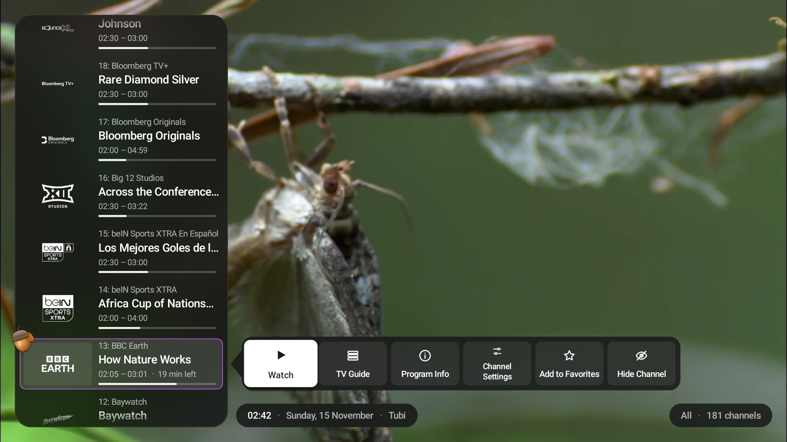
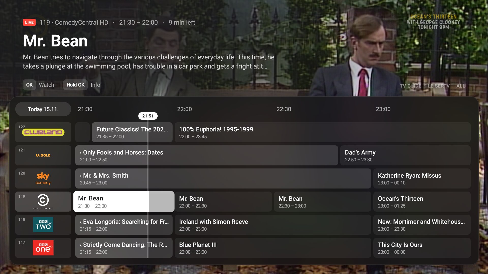
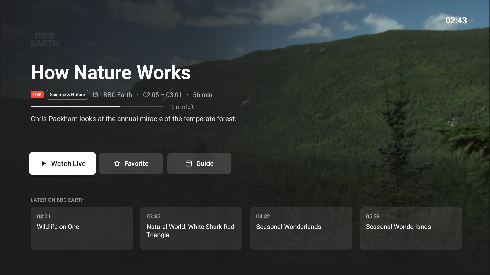
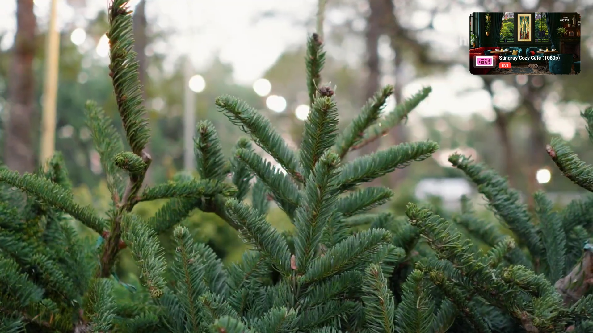
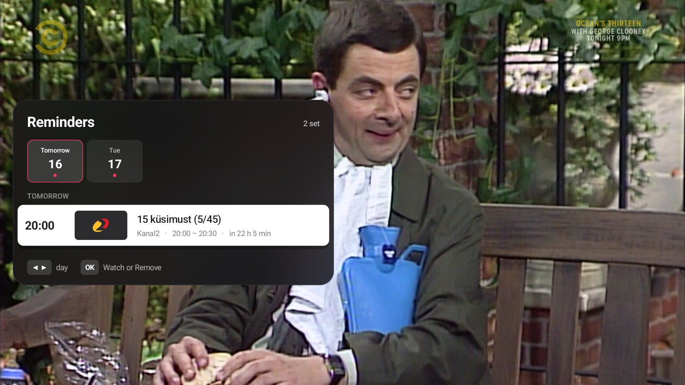
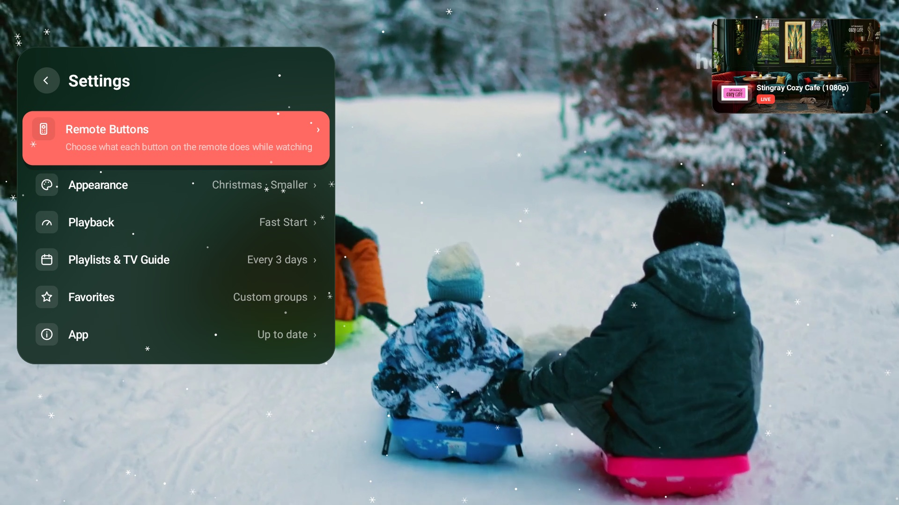
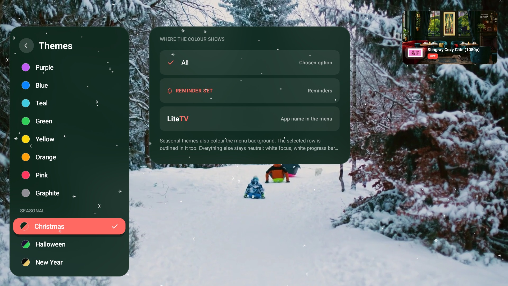
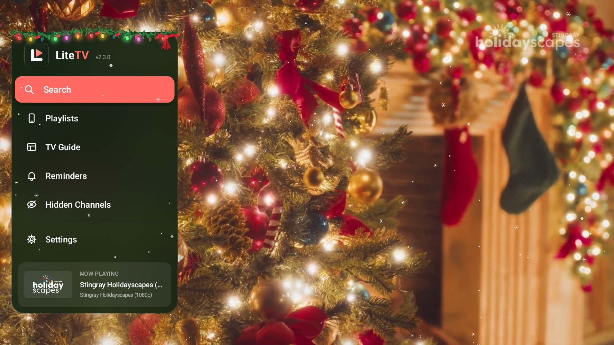
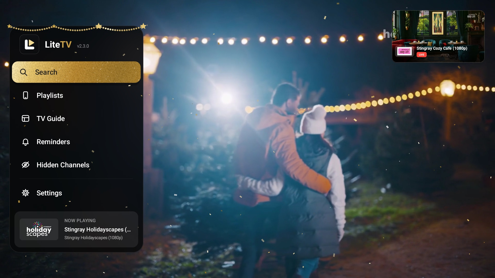
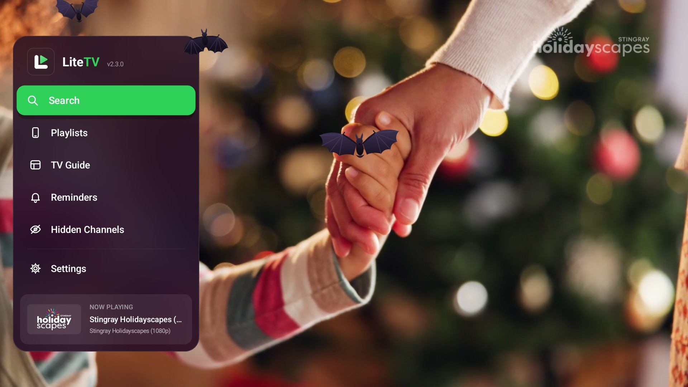

<h1 align="center">
  
</h1>

<p align="center">
  <a href="https://github.com/hertn/LiteTV/releases/latest"></a>
  <a href="https://github.com/hertn/LiteTV#features"></a>
  <a href="https://github.com/hertn/LiteTV/blob/main/LICENSE"></a>
  <a href="https://ko-fi.com/hertn"></a>
</p>

A lightweight live TV (IPTV) app for Android TV. Bring your own M3U playlists and guide (EPG) files; LiteTV plays the channels, shows what's on, and keeps memory use low.

> LiteTV does not include or provide any channels, playlists or guide data. You add your own.

> **100% vibe coded.** Every line of this app was written by AI (Claude) from plain-language instructions. I don't write code myself, so expect rough edges, and use it at your own risk.

## Features

- A clean, Apple TV-style look: dark glass menus over the picture (blurred on TVs that can do it), big clear text and white focus
- Live channels from one or more M3U playlists, with quick switching between playlists
- TV guide (EPG): what's on now with minutes left, a TV Guide grid with every channel across a timeline, a Quick Guide by day for one channel at a time, and a full program info page with what's on later
- Reminders that repeat: press "Remind Me" on a show once and every airing at that time gets one, until you remove it. LiteTV offers to switch when it starts, and the Reminders page lists what's coming
- Guide stored on disk instead of RAM, so memory use stays low even with long guides
- Guide refresh setting (manual, every 6, 12, 24 or 48 hours) and an "Update guide now" button
- Guide length setting (2 to 14 days, limited by what your guide file contains)
- Favorites, hidden channels (unhide them on the Hidden Channels page), and search across all playlists
- The channel list goes round: past the last channel it starts again from the first, with a line marking where
- Pin a channel: it keeps playing muted in a corner while you watch another (handy for waiting out an ad break), and one button swaps the two
- Audio track, subtitles, aspect ratio (Fit, Zoom, Wider, Taller, for shows with black bars) and audio delay per channel (to fix out-of-sync sound)
- Remote Buttons: see what every button does, add your own buttons, and hold OK for the menu on remotes without a Menu button
- Channel logos and clear stream error messages (for example "Server returned HTTP 404 (stream not found)")
- Themes: eight accent colours plus seasonal themes: Christmas (red highlight, garland, falling snow), New Year (sparkling gold, confetti) and Halloween (green highlight, bats flying out of the menu)
- Settings in six clear categories, with a round Back button on every page and pop-up
- Seasonal decorations for holidays (can be turned off)
- Set up playlists and guides from your phone by scanning a QR code
- Backup and restore of playlists, guides and favorites
- An About page with the version, your playlists and guides, and QR codes for GitHub and Ko-fi

## Screenshots

<table>
  <tr>
    <td width="50%" align="center" valign="top"><br><b>Channel list</b></td>
    <td width="50%" align="center" valign="top"><br><b>TV Guide</b></td>
  </tr>
  <tr>
    <td width="50%" align="center" valign="top"><br><b>Quick Guide</b></td>
    <td width="50%" align="center" valign="top"><br><b>Program info</b></td>
  </tr>
  <tr>
    <td width="50%" align="center" valign="top"><br><b>Pin a channel</b></td>
    <td width="50%" align="center" valign="top"><br><b>Channel settings</b></td>
  </tr>
  <tr>
    <td width="50%" align="center" valign="top"><br><b>Reminders</b></td>
    <td width="50%" align="center" valign="top"><br><b>Settings</b></td>
  </tr>
  <tr>
    <td width="50%" align="center" valign="top"><br><b>Remote buttons</b></td>
    <td width="50%" align="center" valign="top"><br><b>Themes</b></td>
  </tr>
  <tr>
    <td width="50%" align="center" valign="top"><br><b>Christmas theme</b></td>
    <td width="50%" align="center" valign="top"><br><b>New Year theme</b></td>
  </tr>
  <tr>
    <td width="50%" align="center" valign="top"><br><b>Halloween theme</b></td>
    <td width="50%"></td>
  </tr>
</table>

## Install

1. Download the latest `LiteTV-x.y.z.apk` from the [Releases](../../releases) page.
2. Install it on your Android TV. The easiest way is with `adb`:
   ```
   adb connect <tv-ip>:<port>
   adb install -r LiteTV-x.y.z.apk
   ```
   Turn on Developer options on the TV first: Settings > Device Preferences > About, tap "Build" 7 times, then enable USB/network debugging.
3. If you have more than one device connected, add `-s <tv-ip>:<port>` after `adb`.

Updating with `adb install -r` keeps your playlists and settings.

## First start

1. Hold OK (or press Menu) on the remote to open the main menu, then choose **Playlists**.
2. Scan the QR code with your phone (or open the address shown on the screen). The phone and the TV must be on the same Wi-Fi network.
3. On the web page, add your playlists (a name and the M3U link) and press **Save**.
4. Guides: either add an EPG link to a playlist on the same page, or open **Shared EPGs** to add one guide that you can apply to all playlists or only some. If a playlist has no guide set, LiteTV uses the one named in the M3U file's header, if it has one.

You can also use **Add Playlist Here** on the TV to type a playlist in with the remote.

## Remote control

| Button | What it does |
| --- | --- |
| Menu / Hold OK | Open the main menu (while watching) |
| OK / Info | What's on, with Program Info, TV Guide, audio, subtitles, aspect ratio and audio delay |
| Left | Open the channel list |
| Right | Open the Quick Guide |
| Guide / Blue | Open the TV Guide grid |
| Up / Down, CH+ / CH- | Change channel |
| 0-9 | Type a channel number |
| Back | Go to the last channel (or step back in menus) |
| Hold Back | Exit the app completely |

You can add your own buttons to any of these in **Remote Buttons**, in Settings.

## Main menu

Search, Playlists, TV Guide, Reminders, Hidden Channels and **Settings**.

**Settings** holds Themes, Font Size, Seasonal Decorations, Blur Behind Menus, Transparency, Buffering (Fast Start or Steady), Sleep Timer, Playlist Refresh, Guide Refresh, Guide Length, Update EPG Now, favorites sorting, Remote Buttons, App Update, the Error Log and About.

## Backup

Open the phone setup page and use **Download backup** to save your playlists, guides and favorites in one file. On another TV, open the same page and use **Restore from file**. Restoring replaces the lists on that TV.

## Build from source

1. Open the project in Android Studio.
2. Let Gradle sync.
3. Build > Build APK(s), or press Run with your TV connected.

The code is Kotlin. `MainActivity.kt` runs the player, `Ui.kt` draws every screen by hand (no layout XML), and playback uses Media3 ExoPlayer.

## Notes

- Guide data is kept in a local database on the TV and is refreshed from the guide links you provide. Only channels that exist in your playlists are stored.
- How many days of guide you get depends on the guide file you use.
- LiteTV is not affiliated with any playlist or guide provider.

## Support

LiteTV is free, with no ads or subscriptions. If you enjoy it, you can [buy me a coffee on Ko-fi](https://ko-fi.com/hertn).

## License

MIT. See the LICENSE file.
