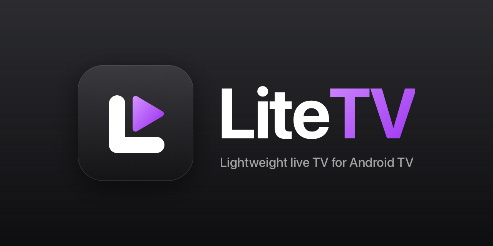
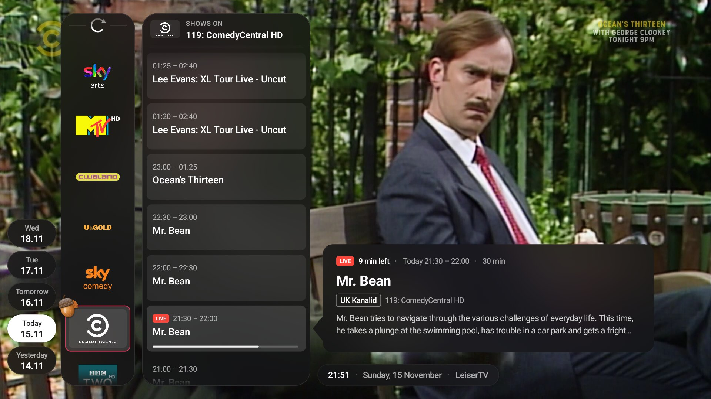
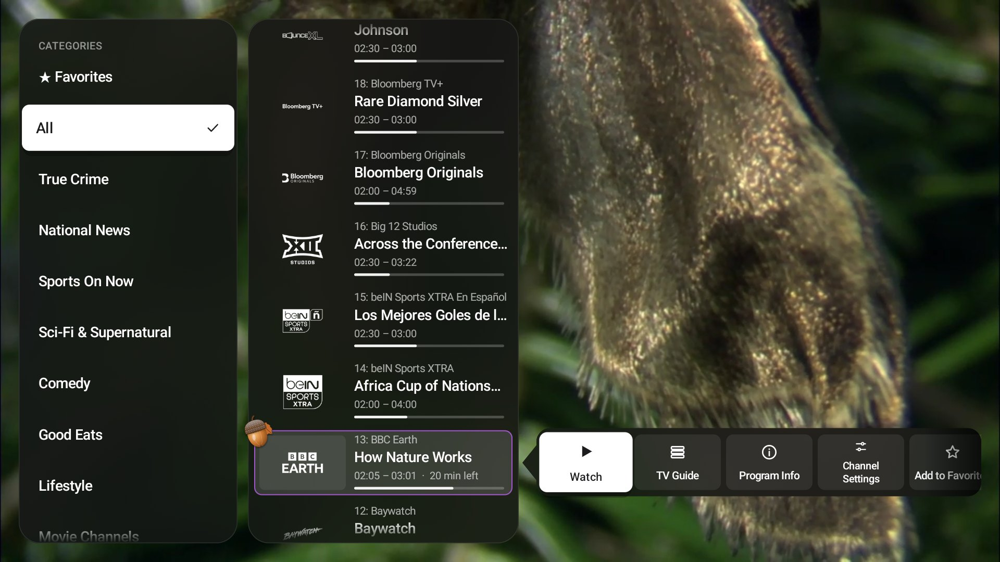
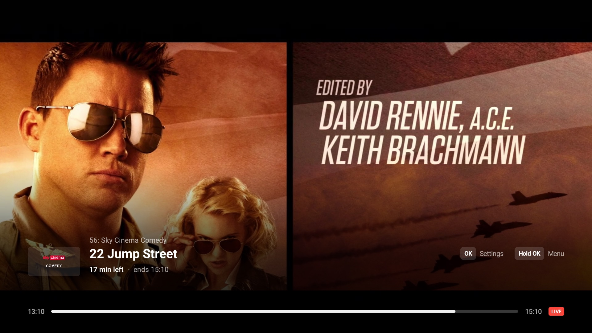
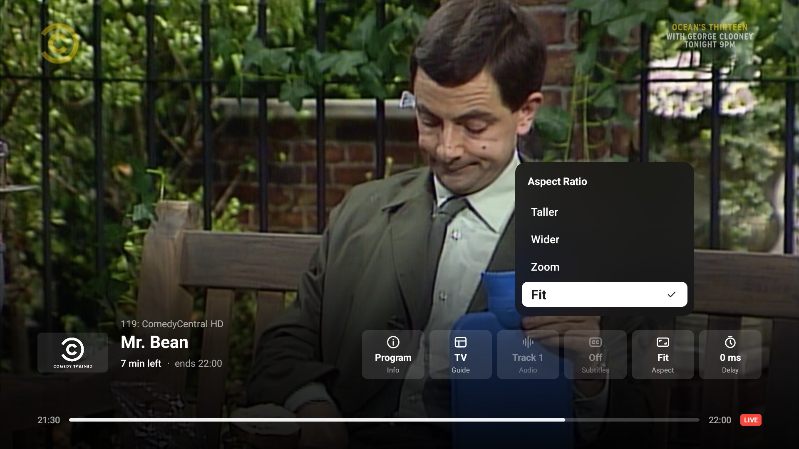
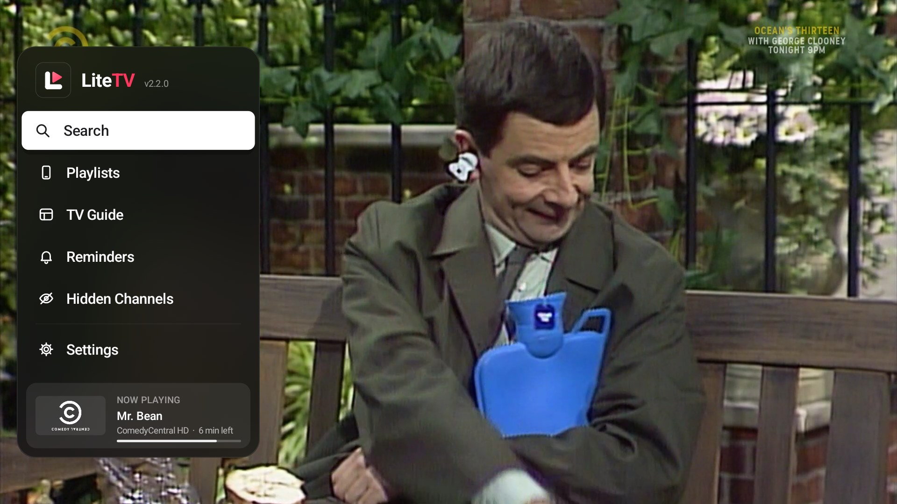
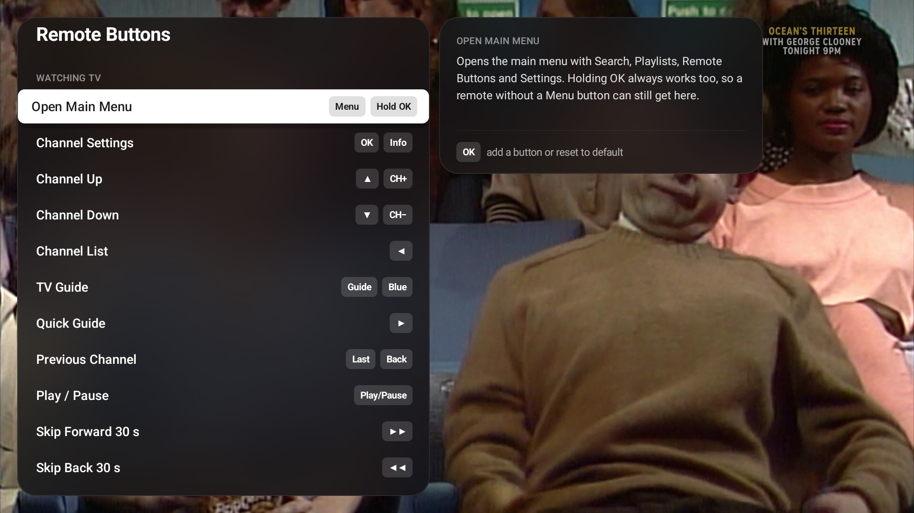

<h1 align="center">
  
</h1>

<p align="center">
  <a href="https://github.com/hertn/LiteTV/releases/latest"></a>
  <a href="https://github.com/hertn/LiteTV#features"></a>
  <a href="https://github.com/hertn/LiteTV/blob/main/LICENSE"></a>
  <a href="https://ko-fi.com/hertn"></a>
</p>

A lightweight live TV (IPTV) app for Android TV. Bring your own M3U playlists and guide (EPG) files; LiteTV plays the channels, shows what's on, and keeps memory use low.

> LiteTV does not include or provide any channels, playlists or guide data. You add your own.

> **100% vibe coded.** Every line of this app was written by AI (Claude) from plain-language instructions. I don't write code myself, so expect rough edges, and use it at your own risk.

## Features

- A clean, Apple TV-style look: dark glass menus over the picture (blurred on TVs that can do it), big clear text and white focus
- Live channels from one or more M3U playlists, with quick switching between playlists
- TV guide (EPG): what's on now with minutes left, a guide by day for every channel, and a full program info page with what's on later
- Reminders: press "Remind Me" on an upcoming show and LiteTV offers to switch when it starts
- Guide stored on disk instead of RAM, so memory use stays low even with long guides
- Guide refresh setting (manual, every 6, 12, 24 or 48 hours) and an "Update guide now" button
- Guide length setting (2 to 14 days, limited by what your guide file contains)
- Favorites, hide/unhide channels, and search across all playlists
- Audio track, subtitle, aspect ratio and audio delay (to fix out-of-sync sound) settings per channel
- Remote Buttons: see what every button does, add your own buttons, and hold OK for the menu on remotes without a Menu button
- Channel logos and clear stream error messages (for example "Server returned HTTP 404 (stream not found)")
- Themes: eight accent colours plus Christmas, Halloween and New Year themes
- Seasonal decorations for holidays (can be turned off)
- Set up playlists and guides from your phone by scanning a QR code
- Backup and restore of playlists, guides and favorites

## Screenshots

<table>
  <tr>
    <td width="50%" align="center" valign="top"><br><b>Channel list</b></td>
    <td width="50%" align="center" valign="top"><br><b>TV guide</b></td>
  </tr>
  <tr>
    <td width="50%" align="center" valign="top"><br><b>Program info</b></td>
    <td width="50%" align="center" valign="top"><br><b>Categories</b></td>
  </tr>
  <tr>
    <td width="50%" align="center" valign="top"><br><b>Changing channel</b></td>
    <td width="50%" align="center" valign="top"><br><b>Channel settings</b></td>
  </tr>
  <tr>
    <td width="50%" align="center" valign="top"><br><b>Main menu</b></td>
    <td width="50%" align="center" valign="top"><br><b>Remote buttons</b></td>
  </tr>
  <tr>
    <td width="50%" align="center" valign="top"><br><b>Settings</b></td>
    <td width="50%" align="center" valign="top"><br><b>Themes</b></td>
  </tr>
</table>

## Install

1. Download the latest `LiteTV-x.y.z.apk` from the [Releases](../../releases) page.
2. Install it on your Android TV. The easiest way is with `adb`:
   ```
   adb connect <tv-ip>:<port>
   adb install -r LiteTV-x.y.z.apk
   ```
   Turn on Developer options on the TV first: Settings > Device Preferences > About, tap "Build" 7 times, then enable USB/network debugging.
3. If you have more than one device connected, add `-s <tv-ip>:<port>` after `adb`.

Updating with `adb install -r` keeps your playlists and settings.

## First start

1. Hold OK (or press Menu) on the remote to open the main menu, then choose **Playlists**.
2. Scan the QR code with your phone (or open the address shown on the screen). The phone and the TV must be on the same Wi-Fi network.
3. On the web page, add your playlists (a name and the M3U link) and press **Save**.
4. Guides: either add an EPG link to a playlist on the same page, or open **Shared EPGs** to add one guide that you can apply to all playlists or only some. If a playlist has no guide set, LiteTV uses the one named in the M3U file's header, if it has one.

You can also use **Add here** on the TV to type a playlist in with the remote.

## Remote control

| Button | What it does |
| --- | --- |
| Menu / Hold OK | Open the main menu (while watching) |
| OK / Info | Channel settings: audio, subtitles, aspect ratio, audio delay |
| Left | Open the channel list |
| Right / Guide / Blue | Open the TV guide |
| Up / Down, CH+ / CH- | Change channel |
| 0-9 | Type a channel number |
| Back | Go to the last channel (or step back in menus) |
| Hold Back | Exit the app completely |

You can add your own buttons to any of these in **Remote Buttons** in the main menu.

## Main menu

Search, Playlists, TV Guide, Show/Hide hidden channels, Last Channel, Remote Buttons and **Settings**.

**Settings** holds Themes, Font Size, Seasonal Decorations, Blur Behind Menus, Transparency, Buffering (Fast Start or Steady), Sleep Timer, Playlist Refresh, Guide Refresh, Guide Length, Update EPG Now, favorites sorting, App Update and the Error Log.

## Backup

Open the phone setup page and use **Download backup** to save your playlists, guides and favorites in one file. On another TV, open the same page and use **Restore from file**. Restoring replaces the lists on that TV.

## Build from source

1. Open the project in Android Studio.
2. Let Gradle sync.
3. Build > Build APK(s), or press Run with your TV connected.

The code is Kotlin. `MainActivity.kt` runs the player, `Ui.kt` draws every screen by hand (no layout XML), and playback uses Media3 ExoPlayer.

## Notes

- Guide data is kept in a local database on the TV and is refreshed from the guide links you provide. Only channels that exist in your playlists are stored.
- How many days of guide you get depends on the guide file you use.
- LiteTV is not affiliated with any playlist or guide provider.

## Support

LiteTV is free, with no ads or subscriptions. If you enjoy it, you can [buy me a coffee on Ko-fi](https://ko-fi.com/hertn).

## License

MIT. See the LICENSE file.
